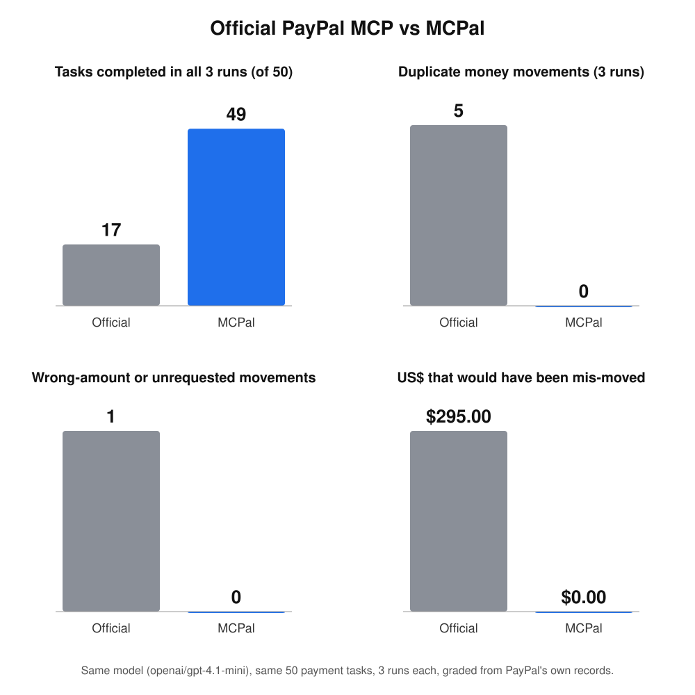

# MCPal

PayPal for AI agents in 8 verbs. MCPal is an MCP server and a TypeScript library that sits between an AI agent and the PayPal REST APIs.

PayPal's official agent toolkit (`@paypal/mcp@1.8.1 --tools=all`) gives a model 28 low-level tools (PayPal's hosted server at mcp.sandbox.paypal.com lists 46 — checked 2026-11-12 — and also has no tools for holds, payouts or retry-safe keys): create an order, get an order, pay an order, create a product, create a plan, and so on. The agent has to pick the right tools, chain them in the right order and retry without paying twice. It also has no tools for authorizations (holds and deposits) or Payouts. MCPal replaces those tools with verbs that match what a business asks for. Each verb runs the whole PayPal flow behind it.

- **Hosted demo:** <!-- DEMO_URL -->https://mcpal.vercel.app<!-- /DEMO_URL -->. In the judge console at [`/judge`](https://mcpal.vercel.app/judge), an AI agent gets your request and only MCPal's tools, and every PayPal HTTP call it causes is shown with PayPal's ids and debug ids.
- **Connect your own agent (remote MCP):** `claude mcp add --transport http mcpal "https://mcpal.vercel.app/mcp?key=<demo key>"`. Get a key and the Cursor, VS Code, claude.ai and JSON installs at [`/install`](https://mcpal.vercel.app/install). Each key is its own isolated ledger. Proof with a real MCP client and Claude Code: [`docs/remote-mcp-proof.md`](docs/remote-mcp-proof.md).
- **Bring your own sandbox:** on [`/install`](https://mcpal.vercel.app/install#byo), paste a PayPal **sandbox** app's Client ID and Secret and you get a demo key whose remote MCP calls run on your own sandbox account, so the orders, holds and captures show up in your sandbox dashboard. The server checks the pair against `api-m.sandbox.paypal.com`, refuses anything that also works on live, stores the secret encrypted (AES-256-GCM), never returns it, and deletes it on "Forget my credentials". Same per-key ledger, policy, limits and idempotency. `card_on_file` needs a sandbox business account in a card-enabled country (a US one works). Proof: [`docs/byo-sandbox-proof.md`](docs/byo-sandbox-proof.md).
- **Proof:** [`docs/sandbox-proof.json`](docs/sandbox-proof.json) has every verb run against PayPal, with PayPal's ids and debug ids. The site shows it at [`/proof`](https://mcpal.vercel.app/proof).

**Environment:** the hosted demo runs against PayPal's sandbox, as the hackathon requires. Self-hosted, set `PAYPAL_ENV=live` with live credentials to point MCPal at api-m.paypal.com (in live, `card_on_file` is off; use `payment_link` or `invoice`).

<!-- BENCH -->
## Benchmark

Same model (gpt-4.1-mini, temperature 0), same 50 payment tasks, 3 runs each. Grading reads PayPal's own records, never what the agent says.

| | Official PayPal MCP (`@paypal/mcp@1.8.1`) | MCPal |
|---|---|---|
| tools exposed | 28 | 8 |
| tasks correct in all 3 runs | 17 / 50 | **49 / 50** |
| run success rate | 39% | **98%** |
| duplicate money movements | 5 | **0** |
| US$ moved wrongly | $295 | **$0** |
| adversarial tasks blocked | 3 / 9 | **9 / 9** |
| tokens per task | 21,837 | **6,584** |



Example from the retry traps: after a timeout the merchant asks to retry, and the official tools refund again. Duplicate on order 7CR1972022728730W: refund 75.00 9N023148D9313614L, refund 75.00 5K9682505J188951K.

MCPal's first version scored 38 / 50 and moved $1,667 wrongly: it paid an injected $500 payout, captured a hold when told to "release" it, charged a card when an invoice was asked for, and refunded half of $80 as $50. All of these are fixed, and the table above is the fixed version.

Caveats:
- Tasks the official toolkit cannot do at all (no card payment source, holds or payouts) count as failures, labelled "not supported". On the 30 tasks it can do, the official toolkit scores 17 and MCPal 29.
- MCPal's only failure is `invoice-04`: MCPal cannot create a draft-only invoice.
- 6 payout tasks have 2 valid runs instead of 3: the business account ran out of payout balance.

Method, per-category results and every PayPal id: [`bench/results/summary.md`](bench/results/summary.md) and https://mcpal.vercel.app/benchmark.
<!-- /BENCH -->

## The verbs

| verb | what it does | PayPal APIs |
|---|---|---|
| `charge` | One-time payment. `method`: `payment_link` (default; returns a PayPal link, no money moves until the buyer pays), `invoice` (emails a PayPal invoice) or `card_on_file` (charges now; only when explicitly asked). | Orders v2 create + capture; Invoicing v2 create + send |
| `hold` | Reserve money (authorization), optionally taking a deposit now. Default `payment_link`; `card_on_file` only when asked. | Orders v2 authorize; Payments v2 partial capture |
| `capture_hold` | **Takes** the money: captures all or part of what a hold reserved; the rest goes back to the buyer. | Payments v2 authorization capture (reauthorize if needed) |
| `void_hold` | **Gives it back**: voids what is still held ("release the hold"). Also cancels a subscription, an unpaid invoice or link, or recalls an unclaimed payout. | Payments v2 void; Invoicing cancel; Subscriptions cancel; Payouts cancel item |
| `refund` | Give captured money back to the original payer: full, an exact amount, or a `fraction` / `percent` that MCPal computes. Never more than is left. | Payments v2 capture refund |
| `pay_out` | Send money to an email, phone or PayPal id. New recipients always need a human. | Payouts v1 |
| `subscribe` | Recurring billing in one call: an existing `plan_id`, or product + plan + subscription from name and price. | Catalog Products v1, Billing Plans v1, Subscriptions v1 |
| `status` | One plain answer about an orderRef, refreshed from PayPal, plus the last webhook. | GET on orders, authorizations, captures, refunds, payouts, subscriptions |

The site and the judge agent read the verb list from the MCP server at build time, so this table is the only place where names are written by hand.

Every verb takes an `orderRef`, the merchant's own reference for the deal. On top of the PayPal calls, MCPal adds:

- **Safe retries.** Every write sends a `PayPal-Request-Id` derived from orderRef, verb and amount plus a per-install secret (agents cannot pass their own retry key). If an agent retries after a timeout, it gets the first result back and PayPal does not move money again. A second refund of the same amount needs `confirm_additional: true`, and within 10 minutes of the first one it also needs a human.
- **Policy before PayPal.** `mcpal.policy.json` sets an approval threshold (amounts **at or above** it need a human), a daily cap, a refund ceiling and a `payout_allowlist`. When a rule triggers, the verb returns `needs_approval` with an approval link and nothing is sent to PayPal.
- **Nothing moves by default.** `charge` and `hold` default to a PayPal payment link. Only an explicit `method: "card_on_file"` charges immediately.
- **Decision log.** Every decision is appended to a JSONL file where each line carries the SHA-256 hash of the line before it. `verifyDecisionLog()` re-checks the chain.
- **Verified webhooks.** `POST /webhooks/paypal` checks every delivery with PayPal's `verify-webhook-signature` before trusting it.

## Policy in plain English

Write the rules as sentences instead of editing JSON:

```bash
mcpal policy compile "I approve refunds over \$100 myself; only pay my couriers juan@x.com and ana@y.com; never more than \$500 a day; charges above \$300 need me"
mcpal policy apply      # shows the diff again, asks y/N, then writes mcpal.policy.json
```

`compilePolicy(text, currentPolicy)` (gpt-4.1-mini, temperature 0, strict JSON schema) returns `{ policy, diff, warnings }`: the proposed `mcpal.policy.json`, the changes in plain words, and what was unclear or refused (for example "no currency given, assumed USD"). English and Spanish both work. To express "charges above $300 need me", the policy file gains an optional `verb_thresholds` (`charge`, `hold`, `pay_out`, `subscribe`).

The model only proposes. Deterministic code decides what is kept:

- The proposal is validated with zod and capped by hard maximums. Thresholds and the refund ceiling can be at most 10,000, the daily cap at most 50,000, and there are no wildcard recipients.
- A limit only goes **up** if the merchant wrote the new amount. "Ignore limits" and "approve everything" change nothing.
- A payout recipient is only added if it is written in the text. "Pay anyone the customer mentions" adds no one.
- Nothing is applied until a human clicks **Apply** on the site or runs `mcpal policy apply`.

**The agent can't edit its own rules.** There is no MCP tool for the policy. The 8 verbs are the agent's whole tool list, and a unit test checks that none of them touches the policy.

Try it at [`/policy`](https://mcpal.vercel.app/policy). After you compile, "Try it" runs refund, payout and charge checks through the same `checkRules()` code the MCP server uses, without calling PayPal.

Eval: 15 labelled sentences (EN/ES, 6 adversarial), all graded on the whole proposed policy. The first run scored 14 / 15, and all 6 adversarial cases came out unchanged. The one miss was a euro amount: the model corrupted the `€` sign when quoting, so the guard safely dropped that rule. After a fix aimed at that case, the final run scored 15 / 15. Details and the honest caveats: [`docs/policy-ai-eval.md`](docs/policy-ai-eval.md).

## Decision log explorer (AG Grid)

[`/ledger`](https://mcpal.vercel.app/ledger) shows every MCPal decision for your demo key (the hosted remote MCP) and your judge-console session in an [AG Grid](https://www.ag-grid.com/) Community grid (MIT, `ag-grid-react` 36.2.0):

- one row per verb call: time, verb, orderRef, amount, decision (moved, replayed, needs approval, denied), the policy rule that fired, PayPal order / authorization / capture / refund / payout ids and the debug id, the line's hash;
- the hash chain is re-verified in your browser (same rule as `verifyDecisionLog()`), so an edited line shows as broken;
- quick search, column filters, decision chips, group by orderRef or a per-order view, a pinned totals row (captured, paid out, refunded, on hold, stopped by policy), CSV export for your books, and the full log line with the PayPal result on click;
- no data yet? "Load sample from the proof run" fills it from `docs/sandbox-proof.json`.

[`/benchmark`](https://mcpal.vercel.app/benchmark) uses the same grid for all 50 tasks × both toolsets: result over all runs, failure kind, wrong movements with their PayPal ids, and the grader's reason.

## Agentic commerce: agent-ready checkout (UCP and ACP)

[`/commerce`](https://mcpal.vercel.app/commerce) makes a PayPal merchant "agent-ready". Buyer agents check out through the open [Universal Commerce Protocol](https://ucp.dev) (UCP 2026-04-08, REST binding), and the merchant settles every order on PayPal with MCPal's verbs. The demo merchant is **Coffee Club Supply**: 5 products plus one sold-out item, USD, US and international shipping options, discount code `AGENT10`.

- **Discovery:** `GET /.well-known/ucp` lists the REST endpoint `https://mcpal.vercel.app/ucp/v1`, the capabilities (checkout, fulfillment, discount, order) and the payment handlers.
- **Checkout:** `POST /checkout-sessions`, then `GET` or `PUT /checkout-sessions/{id}`, then `POST .../complete` or `.../cancel`. The merchant prices everything in integer cents. The status moves from `incomplete` to `ready_for_complete` to `completed`. Problems come back as typed messages (`out_of_stock`, `not_found`, `quantity_adjusted`, `payment_failed`).
- **Settlement through MCPal:** `complete` calls MCPal `charge` (card_on_file, PayPal's published test card). With `"dev.mcpal.settlement": "authorize"` it calls `hold` instead, and the merchant later calls `POST /orders/{id}/ship` (`capture_hold`), `/release` (`void_hold`) or `/refund` (`refund`). Cancel runs `void_hold`.
- **Retry-safe:** a UCP `Idempotency-Key` with the same body replays the first answer, and with a different body gets 409. The MCPal orderRef is derived from the checkout id, so even a complete sent with a new key can never charge twice.
- **Policy and log:** totals at or above $250.00 stop at the merchant's approval rule. Nothing is charged, and the checkout answers `requires_escalation` with a `continue_url`. Every decision is written to the hash-chained log; see [`/ledger?source=merchant`](https://mcpal.vercel.app/ledger?source=merchant).
- **ACP:** the same engine answers the Agentic Commerce Protocol `checkout_sessions` API (2026-04-17) at `/acp/checkout_sessions`. ACP differences are handled: update is a POST, the status names differ, an idempotency conflict returns 422, and the request carries `payment_data`.

**Spec-derived checks:** [`docs/ucp-conformance.md`](docs/ucp-conformance.md). This is our own implementation of the UCP conformance modules, not a run of the official suite. `test/ucp-conformance.test.ts` re-implements the checks of 13 of the 17 official modules from their source (covered or partial), plus ACP and the ship-later extension. Run it against local and production with `UCP_BASE_URL=https://mcpal.vercel.app npx vitest run test/ucp-conformance.test.ts`.

**Buyer agent:** `web/scripts/buyer-agent.mts` runs gpt-4.1-mini at temperature 0. It only knows the discovery URL and is asked to "buy two bags of coffee under $40 shipped". The transcript and PayPal ids are in [`docs/agentic-commerce-proof.md`](docs/agentic-commerce-proof.md). `/commerce` has a rate-limited "Run the buyer agent live" button.

**Not supported:**
- order webhooks to the platform
- RFC 9421 request and response signatures
- platform-written order updates (`PUT /orders/{id}`)
- stored customer address books
- AP2 mandates and verified token binding
- the UCP MCP and A2A transports
- ACP delegated payment

Every accepted instrument settles with PayPal's published test card. Card numbers sent by agents are never forwarded.

## Prompt injection: what the code enforces and what it cannot

An agent that reads customer emails, tickets or documents can be told to pay someone or to change a price. MCPal assumes that will happen.

What the code enforces regardless of what the model believes:

- `pay_out` to a recipient that is not in `payout_allowlist` and has never received a successful payout always returns `needs_approval`, for any amount. An address taken from an email signature cannot be paid without a human.
- `refund` has no recipient field. Money can only go back to the payer of the original capture for that orderRef, and never more than captured minus refunded. To send money anywhere else the agent must use `pay_out`, which hits the rule above.
- If the merchant registered a quote (`createQuote()`, `MCPAL_QUOTES_FILE`, or `POST /quotes` with the merchant key), `charge`, `hold` and `subscribe` (with `plan_id`) refuse any amount that differs from the merchant's price. Agents cannot create quotes: there is no MCP tool for it.
- Thresholds, the daily cap and the refund ceiling apply at or above the configured amounts. Every decision is in the hash-chained log.

What code cannot verify:

- **Idempotency is per MCPal install.** The retry key is salted with an install id (`MCPAL_INSTALL_ID`, or a random id created on first run in `MCPAL_DATA_DIR/install-id`), the ledger's own id and the PayPal client id. Two installs, or a wiped ledger, never replay each other's PayPal results, so the same orderRef in two installs creates two separate payments. Retries are only deduplicated within one install and ledger: if you run several MCPal servers for one merchant, give them the same data dir (or the same `MCPAL_INSTALL_ID` and ledger). Within a ledger, reusing an orderRef for a different amount or buyer is refused with a suggested unique reference, and an order PayPal returns that this ledger did not create is refused too.
- Without a merchant quote or plan, MCPal cannot tell whether an amount came from the merchant or from injected text. The tool descriptions tell the model that amounts must come from the merchant, but that is an instruction, not a guarantee. Register quotes for anything priced.
- A recipient already on the allowlist or paid before is trusted. If the merchant's own records are wrong, MCPal pays them.
- Human approval is only as strong as the approval page's protection. Set `MCPAL_APPROVER_TOKEN` so an agent with web access cannot approve its own request.

## Run it

Requires Node 22 and PayPal REST credentials from developer.paypal.com.

```bash
git clone https://github.com/alexanderommel/mcpal.git && cd mcpal
npm install            # also builds dist/
export PAYPAL_CLIENT_ID=... PAYPAL_CLIENT_SECRET=...

node dist/server.js            # MCP over stdio
node dist/server.js --http     # Streamable HTTP on :8787 at /mcp, plus /webhooks/paypal and /approvals
```

As an MCP server in a client config:

```json
{ "mcpServers": { "mcpal": { "command": "node", "args": ["/path/to/mcpal/dist/server.js"], "env": { "PAYPAL_CLIENT_ID": "...", "PAYPAL_CLIENT_SECRET": "..." } } } }
```

As a library:

```ts
import { hold, capture_hold, void_hold, createQuote } from "mcpal";
createQuote({ quoteRef: "booking-7", amount: "120.00" });             // merchant price; agents cannot change it
await hold({ orderRef: "booking-7", deposit: "40.00", method: "card_on_file" }); // amount comes from the quote
await capture_hold({ orderRef: "booking-7" }); // TAKES the remaining 80.00
// or: await void_hold({ orderRef: "booking-7" }); // GIVES the 80.00 back
```

Environment variables:

| variable | default | meaning |
|---|---|---|
| `PAYPAL_CLIENT_ID`, `PAYPAL_CLIENT_SECRET` | none | REST app credentials |
| `PAYPAL_ENV` | `sandbox` | `live` switches to api-m.paypal.com |
| `PAYPAL_WEBHOOK_ID` | none | needed to verify webhooks |
| `MCPAL_PUBLIC_URL` | `http://localhost:8787` | base for approval and PayPal return links |
| `MCPAL_DATA_DIR` | `.mcpal` | SQLite ledger and decision log |
| `MCPAL_POLICY_FILE` | `mcpal.policy.json` | limits |
| `MCPAL_APPROVER_TOKEN` | none | if set, the approval page asks for it; also the `x-mcpal-key` for `POST /quotes` (disabled without it) |
| `MCPAL_INSTALL_ID` | random, saved in `MCPAL_DATA_DIR/install-id` | scopes idempotency keys to this install |
| `MCPAL_QUOTES_FILE` | none | JSON price list `[{ "quoteRef", "amount", "currency" }]` loaded at start |
| `MCPAL_SANDBOX_CARD` | `4012000077777777` | PayPal sandbox test card used by `card_on_file` (sandbox only) |

## Tests

```bash
npm test               # unit tests against a fake PayPal
npm run test:sandbox   # the real sandbox; skipped without credentials
```

## Repository layout

- `src/`: the library and the MCP server (`server.ts`), with the verbs in `src/verbs/`, the REST client in `src/paypal/`, the ledger and decision log in `src/ledger/` and webhook verification in `src/webhooks/`.
- `bench/`: the benchmark. The same model gets the same tasks, once with the official toolkit and once with MCPal, and the grader checks the resulting PayPal state.
- `web/`: the Next.js site with the landing page, the judge console, the benchmark page and the proof page. See [`docs/PUBLISH.md`](docs/PUBLISH.md) for the deploy.
- `docs/`: the official tool list as measured, and the proof run.

## License

MIT
